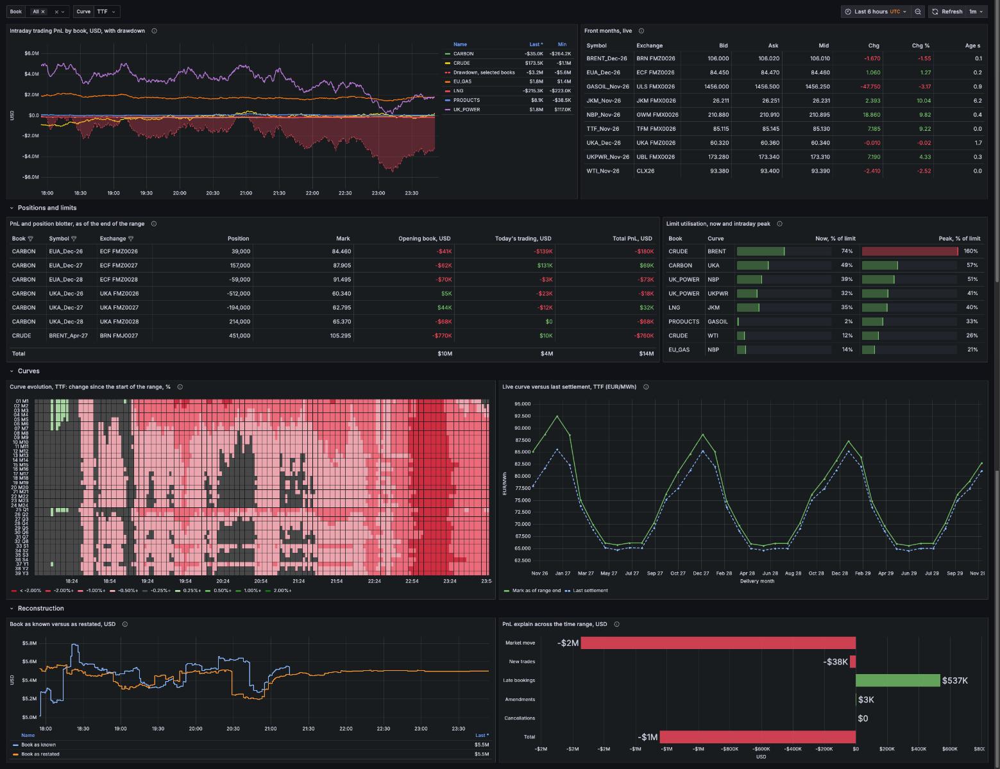

# Dashboards

The same trading desk view, built twice on the generator's tables and views: once in
Grafana and once as a notebook in the QuestDB Web Console. Both read the plain views the
generator creates (see "Views" in `../README.md`), with the `energy_` prefix.

| Folder | What | Load it with |
|---|---|---|
| [`grafana/`](grafana/README.md) | `energy_desk_dashboard.json`: the Energy Trading Desk dashboard, eight panels, for the live session | Grafana > Dashboards > New > Import |
| [`questdb_console/`](questdb_console/README.md) | `energy_trading_notebook.json`: the same desk as a Web Console notebook, eight cells | Web Console > tab menu (top right) > Import tabs |

## Grafana

## QuestDB Web Console

