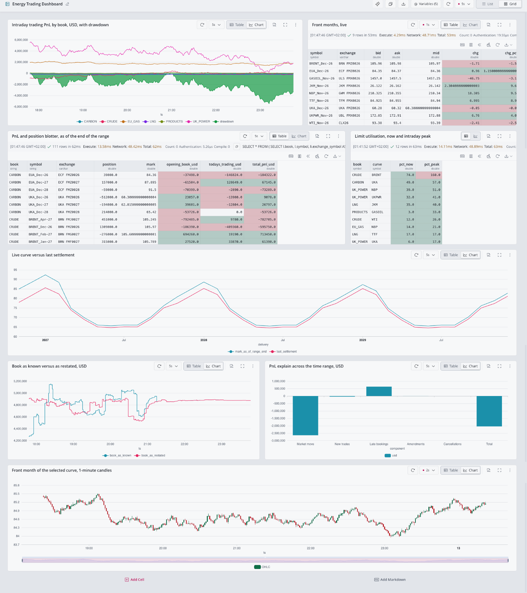

# Energy Trading Dashboard, QuestDB Web Console notebook

The Grafana dashboard (`../grafana/`) rebuilt as a notebook in the QuestDB Web Console,
on the same tables and views. Nothing to install: it runs in the console of the instance
the generator writes to.

## Load it

1. Open the Web Console of the instance that holds the `energy_` tables.
2. Open the tab menu (the three dots at the top right of the editor tabs) and choose
   **Import tabs**.
3. Pick `energy_trading_notebook.json`. It opens as the notebook tab "Energy Trading
   Dashboard", in grid layout, with the cells refreshing every 5 seconds and the front
   months every second.

The table and view names are written out with the `energy_` prefix. For a dataset
loaded with a different `--prefix`, edit the names in the cells.

## Variables

The cells share five notebook variables (the **Variables** button above the grid), the
counterparts of the Grafana time range and drop-downs:

| Variable | Default | Grafana counterpart |
|---|---|---|
| `@asof` | `now()` | the right edge of the time range |
| `@from` | `dateadd('h', -6, @asof)` | the left edge ("Last 6 hours") |
| `@day` | `timestamp_floor('d', @asof)` | the day of the right edge |
| `@book` | `'ALL'`, or one book such as `'CRUDE'` | the Book drop-down |
| `@curve` | `'TTF'` | the Curve drop-down |

Set `@asof` to a past instant to reconstruct the desk as it stood then, as with
dragging the end of the Grafana range.

## How it differs from the Grafana dashboard

- Eight cells, not quite the same eight: there is no curve evolution heatmap, and there
  is a chart Grafana does not have, 1-minute candles for the front month of `@curve`.
- One book or all of them, where Grafana takes any selection of books.
- No planted-event markers on the charts.
- Numbers are shown as the query returns them: no units, currency signs or `K`/`M`
  suffixes, column names as in the SQL, and some doubles with their full binary
  expansion (`60.300000000000004`).
